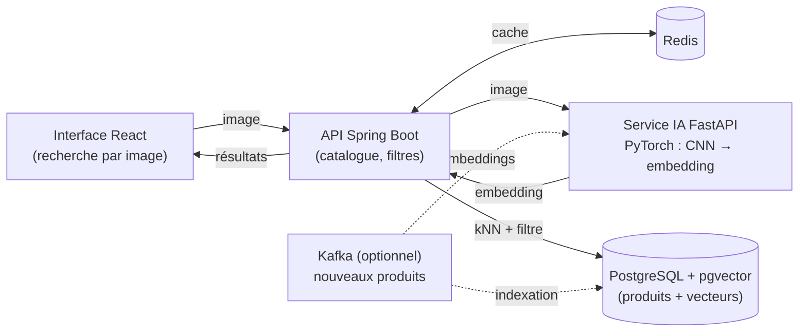

# Architecture

## Déroulement d'une recherche

1. L'utilisateur dépose une image dans l'interface React (`POST /api/search`, multipart, `category` et `k` facultatifs).
2. L'API Spring Boot vérifie le format et la taille, puis transmet l'image au service IA (`POST /embed`). Celui-ci redresse l'image (EXIF), l'aplatit sur fond blanc et applique exactement le prétraitement du catalogue avant le CNN : il renvoie un vecteur normalisé L2.
3. L'API vérifie que la dimension correspond à la colonne `vector(n)`, puis interroge PostgreSQL/pgvector : `ORDER BY embedding <=> requête LIMIT k`, servi par l'index HNSW, avec le filtre `master_category` dans la même requête. `hnsw.ef_search` est fixé par transaction ; avec un filtre, `hnsw.iterative_scan` évite de renvoyer moins de k résultats.
4. Les résultats (produits, URL d'image, score = similarité cosinus, durées) reviennent à l'interface. « Articles similaires » relance la recherche depuis l'embedding d'un produit déjà en base, sans appel au service IA. Les requêtes fréquentes seront servies par Redis (P7).

## Cohérence du modèle

Le modèle qui calcule les embeddings du catalogue (`stylelens.embeddings`, hors ligne) et celui du service IA doivent être identiques : même code de prétraitement (le service importe `ml/stylelens`), même checkpoint. L'import (`stylelens.vectordb load`) écrit le modèle dans `catalog_meta` ; l'API refuse une dimension différente (`502`) et signale un modèle différent dans ses journaux et dans `/api/info`.

## Choix techniques

| Sujet | Choix |
|-------|-------|
| Extraction | CNN pré-entraîné ImageNet (ResNet50, EfficientNet-B0 ou MobileNetV3), sans couche de classification |
| Embedding | sortie de l'avant-dernière couche, normalisée L2 ; après fine-tuning : projection 512-d normalisée L2 |
| Fine-tuning | perte cosinus à marge (CosFace) sur `articleType`, backbone d'abord gelé puis dégelé avec un LR réduit |
| Similarité | cosinus (= produit scalaire sur vecteurs normalisés) |
| Index | HNSW dans pgvector (`vector_cosine_ops`, m = 16, ef_construction = 64), reconstruit après chaque import ; rappel mesuré contre le kNN exact (`stylelens.vectordb evaluate`) |
| Évaluation | Precision@K, Recall@K, mAP ; avec et sans fine-tuning ; latence moyenne et p95 |
| Services | FastAPI (PyTorch CPU) ; Spring Boot 4 (JDBC, Flyway, erreurs RFC 9457) ; React 19 + Vite, servi par nginx |
