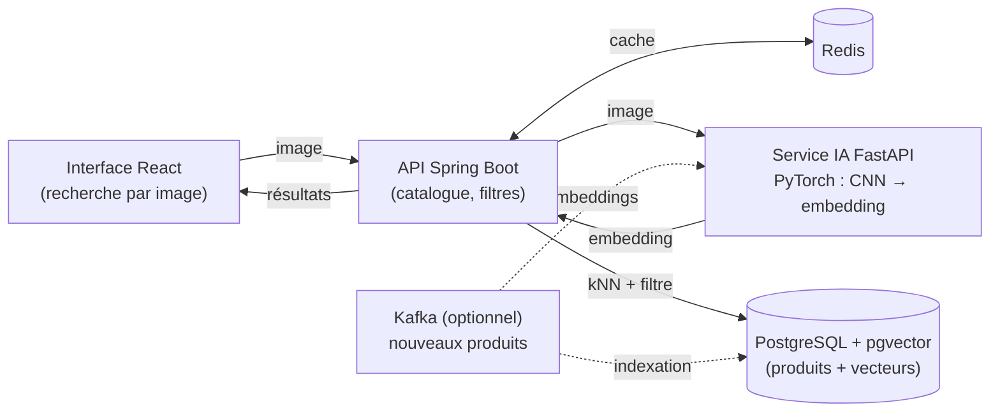

# Architecture

## Déroulement d'une recherche

1. L'utilisateur envoie une image depuis l'interface React.
2. L'API Spring Boot la transmet au service IA, qui renvoie son embedding.
3. L'API interroge PostgreSQL/pgvector : les k vecteurs les plus proches, avec le filtre de catégorie dans la même requête SQL.
4. Les résultats (produits, score de similarité) reviennent à l'interface. Les requêtes fréquentes sont servies par Redis.

## Choix techniques

| Sujet | Choix |
|-------|-------|
| Extraction | CNN pré-entraîné ImageNet (ResNet50, EfficientNet-B0 ou MobileNetV3), sans couche de classification |
| Embedding | sortie de l'avant-dernière couche, normalisée L2 |
| Similarité | cosinus (= produit scalaire sur vecteurs normalisés) |
| Index | HNSW dans pgvector (`vector_cosine_ops`) |
| Évaluation | Precision@K, Recall@K, mAP ; avec et sans fine-tuning ; latence moyenne et p95 |
